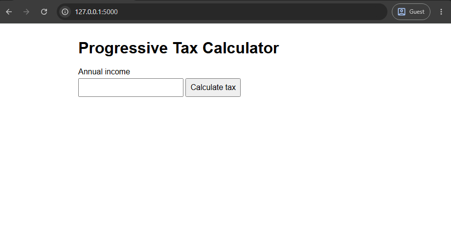

# Tax Calculator

A simple progressive tax calculator built with Flask. Enter an annual income and it shows the tax owed using three brackets: 15% up to $20,000, 25% up to $50,000, and 35% above that.

## Built With
- Python
- Flask

## Running Locally
1. `pip install flask`
2. `python app.py`
3. Open `http://127.0.0.1:5000`

## Screenshot
